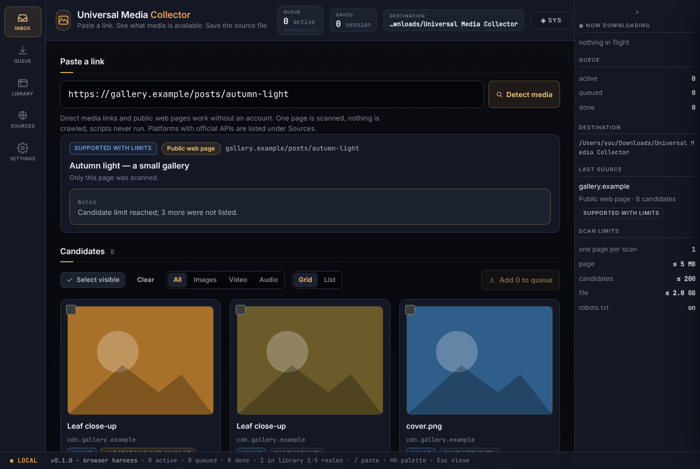
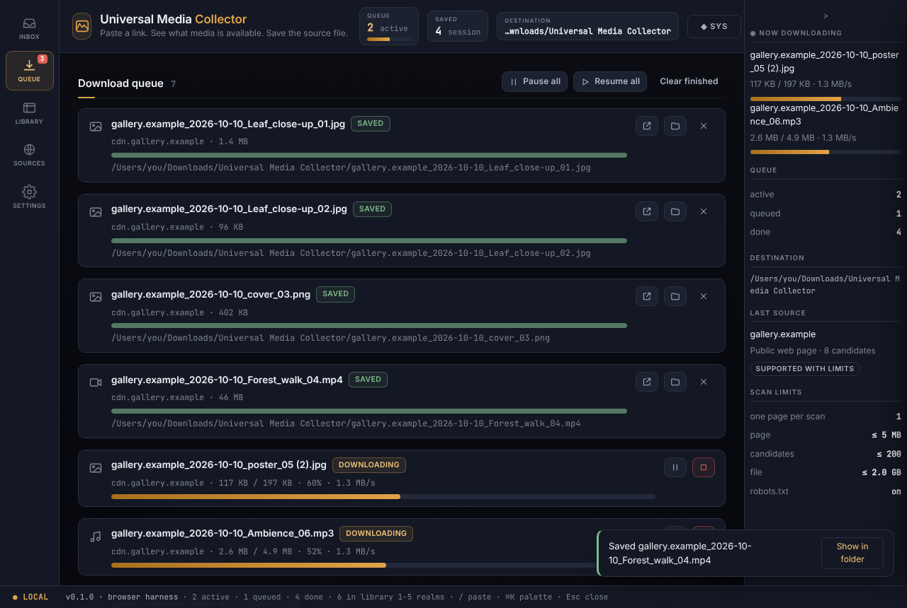
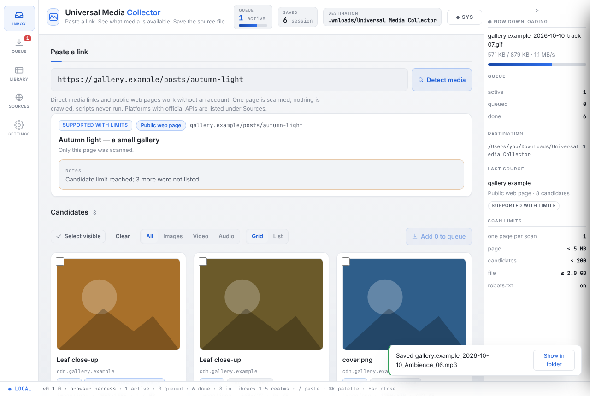
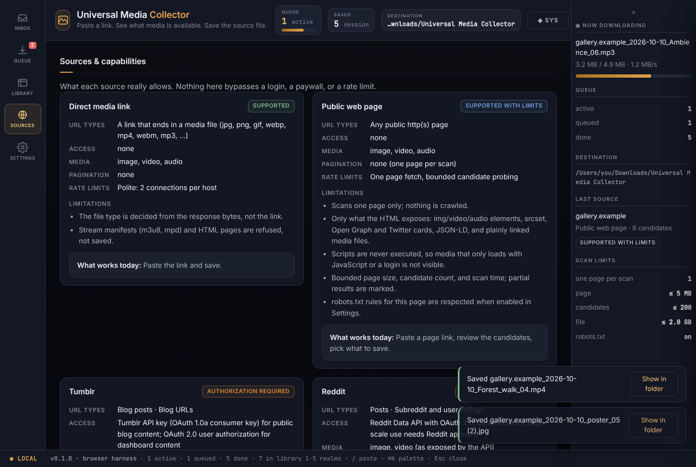

# Universal Media Collector

> Paste a link. See what media is actually available. Save the best source file the page or an authorized source exposes.

A local-first desktop app for personal archiving, creator-owned content, and media you have permission to keep. It never promises every URL works, never upscales and calls it "original", and never defeats an access control. The interface is the **WorkspaceHQ NEXUS v3** shell: a sigil rail, a status topstrip with a SYS menu, a center stage, a collapsible ambient rail, a statusbar, a `Ctrl/Cmd+K` palette, and the NEXUS (dark) / DAYLIGHT (light) themes.

```
universal-media-collector/
├── main.js · preload.js · index.html      Electron entry, sandboxed bridge, renderer shell
├── main/                                  main process (Node): all network + file work
│   ├── url-safety.js  net.js              URL/SSRF guard, pinned-DNS safe fetch
│   ├── source-detector.js  sources.js     host classification, capability registry
│   ├── html-parse.js  sniff.js  robots.js candidate discovery, type-from-bytes, robots.txt
│   ├── adapters/{direct,webpage,platform} resolvers (honest boundaries for platforms)
│   ├── resolver.js  preview.js            ResolverResult, verified image previews
│   ├── download-manager.js  file-service.js  queue, resume, verify, atomic commit
│   ├── settings.js  library.js  json-store.js  validated settings, history, quarantine
│   ├── errors.js                          the error taxonomy
│   └── ipc.js                             validated IPC surface
├── src/                                   renderer (vanilla ES modules, no build step)
│   ├── core/{bus,registry,shell,chrome,ambient,palette,store,themes,lexicon,onboarding,boot}.js
│   ├── realms/{inbox,queue,library,sources,settings}/{manifest,view}.js
│   ├── ui/{util,icons,toast,drawer,modal}.js
│   └── lexicon/lexicons.js                en + fr strings (RTL-ready mechanism)
├── styles/                                tokens · base · components · chrome · palette · nexus · daylight · realms/*
├── test/                                  node:test suites + a local fixture server
└── tools/                                 mock bridge, browser harness, screenshot sweep
```

## Run

Requirements: Node 20+ (22 recommended), npm. Electron is installed by npm.

```sh
cd universal-media-collector
npm install
npm start            # the app
npm test             # 55 tests: URL safety, parsing, naming, queue states, resolver fixtures
npm run selftest     # Electron: mounts every realm under every theme, logs SELFTEST … PASS
npm run harness      # renderer in a plain browser with a mock bridge → http://127.0.0.1:4173/
node tools/shots.mjs # Playwright screenshot sweep of every realm/theme/language (→ _shots/)
```

There is no build step: edit a file, reload the window.

## What works today

| Source | State | What you get |
|---|---|---|
| **Direct media link** (jpg, png, gif, webp, avif, mp4, webm, mov, mp3, m4a, flac, wav, …) | Supported | One ranged request, type decided from the bytes, size/dimensions when the file states them, then save with byte-count + SHA-256 verification. |
| **Public web page** | Supported with limits | One page fetch, no scripts, no crawling. Candidates from `` (incl. the largest `srcset` entry), `<picture>`, `<video>`/`<audio>`/`<source>`, poster frames, Open Graph / Twitter cards, JSON-LD `ImageObject`/`VideoObject`/`AudioObject`, and plainly linked media files. The first 24 candidates are probed for type, size, and header dimensions. |
| **Tumblr** | Authorization required | Not integrated yet. Only the official API will ever be used (see *Platform integrations*). Direct `64.media.tumblr.com` files work through the direct resolver. |
| **Reddit** | Authorization required | Not integrated yet. Official Data API with OAuth only. Direct `i.redd.it` files work through the direct resolver. |
| **Instagram, Facebook** | Unavailable | No approved path exposes arbitrary post media to a third-party desktop app. The app says so and points to the platform's own export flow. |
| **YouTube, X, TikTok** | Unsupported | Script-driven, signed delivery; extracting streams means working around the platform. Not done. |
| **Anything else** | Generic page resolver | The bounded public-page scan above. |

Authentication is never required for direct links or public pages.

### Quality labels (never fabricated)

`direct` — you pasted the file itself · `largest variant on page` — the biggest `srcset`/`<picture>` entry · `page variant` — a smaller listed variant · `page metadata` — Open Graph / JSON-LD · `thumbnail` — a poster or `thumbnailUrl` · `quality unknown` — nothing on the page says more. Dimensions come from attributes, metadata, or the file header, each marked; otherwise "dimensions unknown".

### Limits (Settings)

One page per scan · page ≤ 5 MB (max 20) · ≤ 200 candidates (max 500) · 24 probed per scan (max 60) · file ≤ 2 GB (max 16) · queue ≤ 20 GB · 2 parallel downloads (max 4), 2 connections per host · robots.txt honored for page scans (toggle). Partial results are labelled as such.

## User journeys

- **Direct media**: paste → the file is identified from its bytes → one click "Save this file" → progress → byte count and SHA-256 checked → recorded in the Library.
- **Public page**: paste → "Only this page was scanned" → review the candidates (grid or list, kind filter, previews) → select → "Add N to queue".
- **Unsupported / private URL**: the capability state, a plain-language reason, and the next useful action (open in a browser, use the platform export, paste a direct link). Nothing retries in the background.
- **Conflicts**: a file name that already exists asks: skip, save as a new name, or replace. Never a silent overwrite. The default policy is "ask"; "skip" and "rename" are selectable, "replace" is never a default.

## Files, names, and data

Default template `{source}_{date}_{title-or-id}_{index}.{ext}`. Tokens: `{source}` `{host}` `{date}` `{time}` `{title}` `{id}` `{title-or-id}` `{index}`. Every component is sanitized (separators, control and bidi characters, reserved Windows device names, length); the extension always comes from the saved file's detected type, never from the template or the URL. Collisions resolve to `name (2).ext`, `name (3).ext`. Files go only to the chosen destination; the final path is checked to be inside it.

Downloads stream to `<destination>/.umc-partial/<job>.part` and are committed with a hard link (atomic, fails if the target exists) or a rename fallback. Byte count is checked against `Content-Length`, and the SHA-256 of what hit the disk is recorded.

Stored locally (`settings.json`, `library.json` in the Electron userData folder): settings; per saved file the source page and link **without query strings**, local path, original and final names, type, size, SHA-256, dimensions, quality label, how it was found, your tags and note. Stores are written atomically; a corrupt store is quarantined (`*.corrupt-<ts>`) instead of being overwritten with an empty one. The queue lives in memory for the session. No analytics, no telemetry, no cloud.

## Security model

- URLs are untrusted: http/https only; no embedded credentials; local hostnames refused; loopback, private, link-local, multicast, reserved, cloud-metadata ranges refused for IPv4 and IPv6 (including mapped, NAT64, 6to4 forms). DNS is resolved by the app and the socket is pinned to the validated address, so a rebinding name cannot pass the check and then connect elsewhere. Every redirect hop is re-validated; https→http downgrades are refused; at most 5 hops.
- The response decides the type (magic bytes first). HTML pages and stream manifests are refused as "media"; a direct link that turns out to be a page is scanned as a page instead.
- Header and idle-body timeouts, bounded reads, per-host concurrency, honest `User-Agent: UniversalMediaCollector/<version> (local desktop app; …)`. No cookies, no spoofing.
- Renderer: `contextIsolation`, `sandbox`, no Node, CSP `default-src 'self'`, `connect-src 'self'` (icon sprite only), `img-src 'self' data:` — previews are fetched and verified main-side and handed over as `data:` URLs, so the page never loads a remote URL. Navigation and popups are blocked. The IPC surface is narrow and validated; "open file / show in folder" accept only paths the app itself produced.
- Out of scope by design: login/paywall/CAPTCHA/bot-check bypass, DRM, cookie or session import, credential collection, proxy rotation, fingerprint spoofing, profile crawling, watermark removal, reposting.

## Error codes

`INVALID_URL` `UNSUPPORTED_SCHEME` `UNSUPPORTED_SOURCE` `AUTHORIZATION_REQUIRED` `ACCESS_DENIED` `RATE_LIMITED` `ROBOTS_OR_POLICY_BLOCK` `NO_MEDIA_FOUND` `PARTIAL_RESULTS` `UNSUPPORTED_MEDIA` `NETWORK_TIMEOUT` `SOURCE_UNAVAILABLE` `FILE_TOO_LARGE` `DISK_FULL` `FILE_CONFLICT` `INTEGRITY_CHECK_FAILED` `CANCELLED` — each carries a plain message and a next step; none ever carries a secret or a signed URL. Transient codes (`NETWORK_TIMEOUT`, `SOURCE_UNAVAILABLE`, `RATE_LIMITED`) are retried up to three times with backoff (honoring `Retry-After`); permanent ones are not.

## Platform integrations (gated)

Each platform adapter is an honest boundary today: it returns the capability state and the next action, with no scraping fallback. Official documentation to use when wiring them:

- **Tumblr** — API v2: <https://www.tumblr.com/docs/en/api/v2> · register an app: <https://www.tumblr.com/oauth/apps>. Public blog content needs an API key (OAuth 1.0a consumer key); dashboard content needs OAuth 2.0 user authorization. Read media blocks/URLs as returned; keep `original_dimensions` metadata where exposed.
- **Reddit** — Data API wiki: <https://support.reddithelp.com/hc/en-us/articles/16160319875092-Reddit-Data-API-Wiki> · API reference: <https://www.reddit.com/dev/api/> · Developer Terms: <https://redditinc.com/policies/developer-terms>. OAuth 2.0 client registration, rate limits per the wiki, content-retention/deletion obligations, and approval for commercial or large-scale use.
- **Instagram / Facebook** — Instagram Platform: <https://developers.facebook.com/docs/instagram-platform/> · Graph API: <https://developers.facebook.com/docs/graph-api/>. Media access needs a reviewed app, the required scopes, and the content owner's consent; this app has no such integration. Export flows: Instagram <https://help.instagram.com/181231772500920>, Facebook <https://www.facebook.com/help/212802592074644>.

When an adapter lands, tokens go to the OS credential vault (e.g. `keytar` or Electron `safeStorage`), never to disk, logs, crash reports, or renderer storage; the UI must show provider, scopes, data handled, disconnect/revoke, and local-data deletion.

## Localization

English and French ship. The lexicon mechanism mirrors v3's `LX()`; a table can declare `_dir: 'rtl'` and the shell flips `dir` and uses logical CSS properties. No Arabic table ships yet, so none is claimed.

## Deviations from the build brief, stated plainly

- **Electron + vanilla ES modules, not Tauri + React.** The brief's default stack applies to an empty repo; the requirement here was the same interface as WorkspaceHQ NEXUS v3, which is an Electron, no-build renderer. Reusing that substrate gives a faithful shell and lets the realms share one contract with the HQ app.
- **JSON stores, not SQLite.** Electron 32 bundles Node 20 (no `node:sqlite`), and native SQLite modules need per-Electron rebuilds that a no-build repo should not carry. The `LibraryRepository` interface is small and swappable; stores are atomic and quarantine-on-corrupt.
- **Queue is not persisted across restarts.** Partial files are removed on cancel unless "keep partial files" is on; a restart forgets in-memory jobs.
- **No OAuth adapters yet** (see above). The capability registry and the adapter boundary exist so that adding one does not touch the generic flows.

## Status

Verified: 55 `node:test` cases (URL safety, candidate normalization, filename sanitization, queue states, resolver fixtures, download flows incl. pause/resume, conflicts, retries, caps, integrity), the Electron selftest (10 realm×theme combos, 0 errors) under Xvfb, and a Playwright sweep of 20 screens with zero console errors. Real-network behaviour beyond the fixture server has not been exercised in CI.

## Screenshots

| Inbox (NEXUS) | Queue (NEXUS) |
|---|---|
|  |  |

| Inbox (DAYLIGHT) | Sources |
|---|---|
|  |  |
